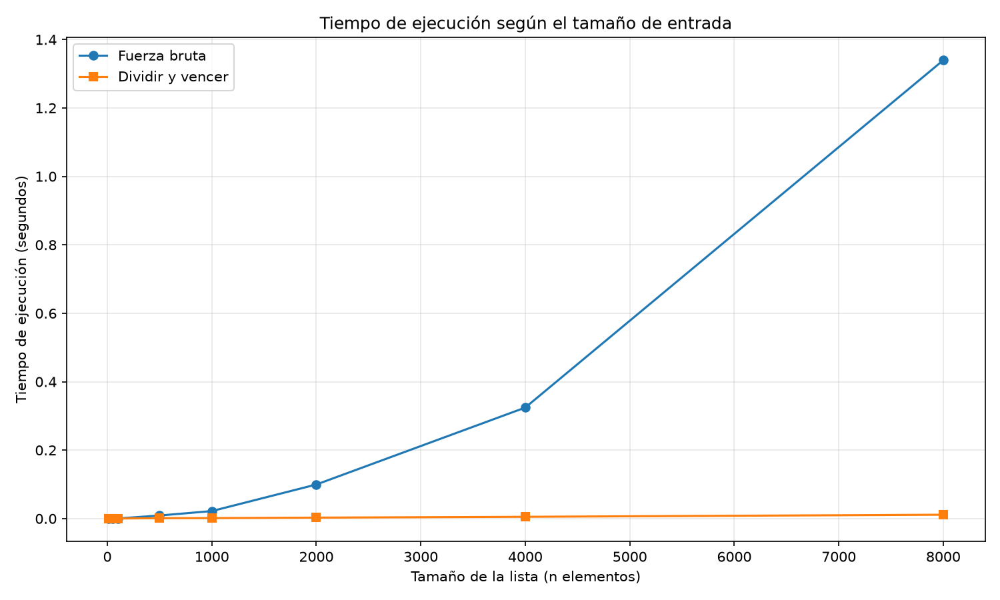

# Laboratorio evaluativo 02: Dividir y vencer

**Estudiante: Juan Felipe Torres Torres**

## Ejecución

Desde la raíz del repositorio, activar el entorno virtual y ejecutar:

```powershell
.\venv\Scripts\Activate.ps1
python "laboratorios/lab2-divide-y-vencer/pruebas.py"
python "laboratorios/lab2-divide-y-vencer/medicion.py"
```

## Parte 1. Implementación

Se implementaron dos algoritmos para encontrar el subarreglo contiguo con suma máxima.

**Archivos del desarrollo:**

- [Código de los algoritmos: subarreglo.py](subarreglo.py)
- [Pruebas automatizadas: pruebas.py](pruebas.py)

La solución por fuerza bruta examina los posibles subarreglos y acumula sus sumas, con complejidad temporal \(\Theta(n^2)\). La solución de dividir y vencer resuelve recursivamente las dos mitades y calcula la mejor solución que cruza el punto medio.

Las pruebas verifican el ejemplo principal, listas de un elemento, listas con valores negativos y positivos, un caso en el que la solución cruza el punto medio y 20 listas aleatorias. En todos los casos aleatorios, ambos algoritmos deben coincidir en la suma máxima.

## Parte 2. Medición

**Archivo de medición:** [medicion.py](medicion.py)

Se comparó el tiempo de ejecución de ambos algoritmos para listas de 10, 50, 100, 500, 1.000, 2.000, 4.000 y 8.000 elementos. Los valores enteros se generaron aleatoriamente entre -100 y 100 mediante una semilla fija (`42`), lo que permite reproducir los datos.

Para cada tamaño se utilizó la misma lista en ambos algoritmos y se realizaron tres mediciones por algoritmo. El tiempo se obtuvo con `time.perf_counter()` y se tomó la mediana de las tres ejecuciones. Además, se verificó que ambos algoritmos devolvieran la misma suma máxima.

La gráfica presenta ambas curvas en los mismos ejes y permite comparar cómo crece el tiempo de ejecución al aumentar el tamaño de entrada.



Para 8.000 elementos, la fuerza bruta tardó 1,339437 segundos, mientras que dividir y vencer tardó 0,011330 segundos. En esta medición, dividir y vencer fue aproximadamente 118 veces más rápido.

## Parte 3. Análisis

**1. Recurrencia y método maestro**

En dividir y vencer, cada llamada resuelve dos subproblemas de tamaño aproximado \(n/2\). Además, calcular la solución que cruza el punto medio requiere recorrer ambas mitades en tiempo lineal. Por tanto:

\[
T(n)=2T(n/2)+\Theta(n)
\]

En el método maestro, \(a=2\), \(b=2\) y \(f(n)=\Theta(n)\). Como \(n^{\log_b a}=n\), corresponde al caso 2, por lo que la complejidad es \(\Theta(n\log n)\).

**2. Complejidad de fuerza bruta**

La fuerza bruta tiene complejidad \(\Theta(n^2)\), porque considera todos los posibles inicios y finales de los subarreglos. La suma se actualiza acumulativamente, evitando recalcular cada subarreglo desde cero.

**3. Factores de crecimiento**

Cuando el tamaño se duplica de 1.000 a 2.000, el tiempo de fuerza bruta creció 4,54 veces y el de dividir y vencer 1,95 veces. De 4.000 a 8.000, los factores fueron 4,13 y 2,18, respectivamente. Son resultados experimentales aproximados, consistentes con los crecimientos cuadrático y \(n\log n\).

**4. Punto de cruce**

La primera ventaja observable de dividir y vencer aparece en \(n=50\), aunque la diferencia es mínima. Desde \(n=100\), su ventaja es más clara. El punto exacto depende del equipo y de las condiciones de ejecución.

**5. Comparación y recomendación**

Para encontrar el elemento máximo de una lista basta recorrerla una vez, con complejidad \(\Theta(n)\). Dividir la lista recursivamente también puede resolverlo en tiempo lineal, pero añade llamadas recursivas innecesarias.

Para encontrar el subarreglo de suma máxima, recomiendo dividir y vencer cuando el volumen de datos sea grande. Extrapolando desde \(n=8.000\) mediante los modelos teóricos, para un millón de elementos se estiman aproximadamente 5,8 horas para fuerza bruta y 2,2 segundos para dividir y vencer. Son estimaciones, no mediciones reales; el tiempo efectivo dependerá del equipo y de la implementación.
