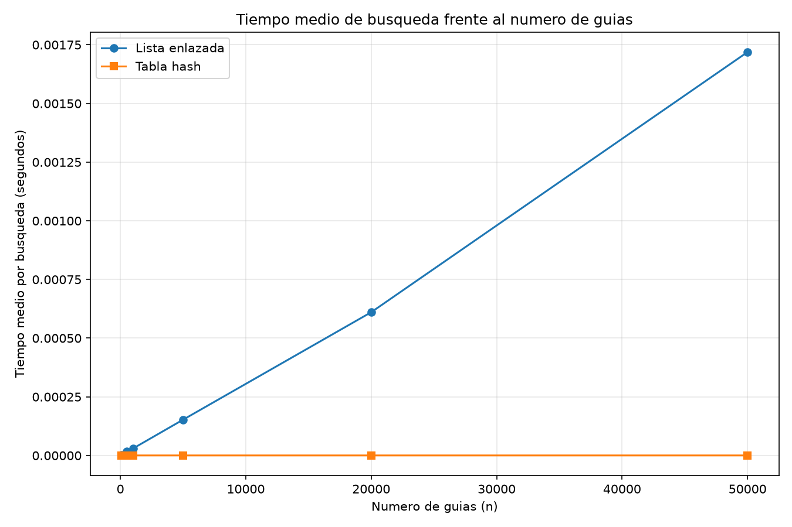
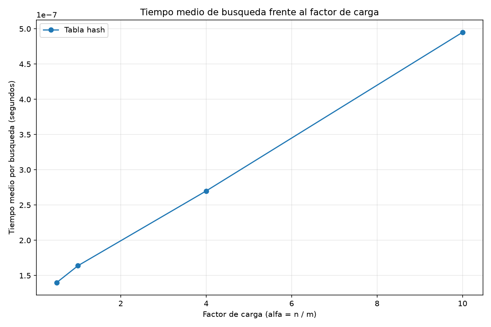

# Laboratorio 3 — Estructuras de datos

**Estudiante: Juan Felipe Torres Torres**

## Instrucciones de reproducción

Desde la raíz del repositorio, active el entorno virtual y ejecute las pruebas y las mediciones:

```powershell
.\venv\Scripts\Activate.ps1
python laboratorios/lab3-estructuras-datos/pruebas.py
python laboratorios/lab3-estructuras-datos/medicion.py
```

Las pruebas verifican las búsquedas exitosas e infructuosas, las colisiones y la equivalencia entre las dos estructuras. Las mediciones generan las gráficas dentro de la carpeta `graficas/`.

## Parte 1 — Implementar y verificar las estructuras

Código: [estructuras.py](estructuras.py) y [pruebas.py](pruebas.py).

Se implementaron una lista simplemente enlazada con inserción al inicio y una tabla hash con resolución de colisiones por encadenamiento. La tabla reutiliza listas enlazadas en sus casillas y emplea el método de división para calcular los índices.

Las pruebas comprobaron búsquedas exitosas e infructuosas, la colisión de las guías 10, 24 y 17 en la casilla 3 de una tabla de tamaño 7, el factor de carga de 3/7 y veinte colecciones aleatorias. En estas últimas se compararon los resultados de ambas estructuras para guías existentes e inexistentes.

Todas las pruebas finalizaron correctamente.

## Parte 2 — Medir y graficar

Código: [medicion.py](medicion.py).

Se utilizó `time.perf_counter()` para medir el tiempo medio de 200 búsquedas de guías inexistentes. La generación de datos y la construcción de las estructuras se realizaron fuera del cronómetro. Se emplearon semillas fijas para reproducir los experimentos.

### Experimento A: lista enlazada frente a tabla hash



Se evaluaron 100, 500, 1.000, 5.000, 20.000 y 50.000 guías. El tamaño de la tabla se eligió como un número primo cercano a la mitad de la cantidad de guías.

Los tiempos medios medidos para la lista fueron, respectivamente, 0,00000308; 0,00001740; 0,00002950; 0,00015250; 0,00061046 y 0,00171890 segundos. Para la tabla hash fueron 0,00000020; 0,00000018; 0,00000020; 0,00000019; 0,00000020 y 0,00000020 segundos.

La lista presenta un crecimiento general del tiempo, mientras que el tiempo de la tabla se mantiene aproximadamente estable en las cifras registradas.

### Experimento B: efecto del factor de carga



Se mantuvieron 20.000 guías y se evaluaron factores de carga de 0,5; 1; 4 y 10. Los tiempos medios fueron 0,00000014; 0,00000016; 0,00000027 y 0,00000049 segundos, respectivamente.

El tiempo aumentó con el factor de carga, lo que concuerda con el mayor número promedio de elementos que comparten una casilla.

## Parte 3 — Análisis

### 1. Costo teórico

En una lista enlazada, una guía inexistente obliga a revisar todos los nodos. Por eso, el costo de búsqueda es Θ(n). En una tabla hash con encadenamiento, se calcula el índice y se revisa la lista de esa casilla. Bajo el supuesto de hash uniforme simple, el costo promedio es Θ(1 + α), donde α = n/m. Si todas las guías caen en una sola casilla, la búsqueda puede degradarse a Θ(n).

### 2. Lo medido contra lo esperado

Entre 100 y 500 guías, el tiempo de la lista se multiplicó por 5,65, mientras que n se multiplicó por 5. Entre 5.000 y 20.000 guías, ambos factores fueron aproximadamente 4. Entre 20.000 y 50.000, el tiempo de la lista se multiplicó por 2,82 frente a un aumento de 2,5 veces en n. Esto es coherente, aproximadamente, con Θ(n).

En la tabla hash, los tiempos registrados permanecieron entre 0,00000018 y 0,00000020 segundos en el primer experimento. Las pequeñas diferencias no permiten afirmar un costo exactamente constante, pero son compatibles con el comportamiento promedio esperado. En el segundo experimento, el tiempo aumentó de 0,00000014 a 0,00000049 segundos al pasar de α = 0,5 a α = 10, en concordancia con Θ(1 + α).

### 3. Explique las colisiones

Una colisión ocurre cuando dos guías producen el mismo índice, incluso si hay más casillas que guías, porque la función hash transforma muchas claves posibles en un conjunto limitado de índices. Con m = 7, las guías 10, 24 y 17 producen el índice 3 mediante el residuo de la división. El encadenamiento almacena las tres en una lista de esa casilla, lo que facilita las inserciones, aunque puede requerir memoria adicional para los nodos y recorrer varios elementos. El direccionamiento abierto busca otra casilla disponible dentro de la tabla: evita listas externas, pero puede sufrir agrupamiento y requiere espacio libre para insertar.

### 4. Tabla hash o árbol de búsqueda

La tabla hash no permite obtener eficientemente todas las guías comprendidas entre X y Y, porque sus índices no conservan el orden de las claves. Un árbol de búsqueda binario permite recorrer las claves ordenadamente y consultar rangos. Si se insertan 400.000 guías ya ordenadas en un árbol binario sin equilibrar, este puede degenerar en una cadena de 400.000 nodos, con altura de 399.999 aristas y hasta unas 400.000 comparaciones en una búsqueda. En un árbol equilibrado, la altura sería del orden de log₂(400.000), aproximadamente 19 aristas, con alrededor de 19 a 20 comparaciones.

### 5. Concepto para la jefa de operaciones

Recomiendo combinar una tabla hash para las consultas puntuales del call center con un árbol de búsqueda equilibrado para el monitoreo por rango. La tabla hash resuelve bien las búsquedas de claves individuales, mientras que el árbol mantiene las guías ordenadas.

Para estimar el tiempo con 5.000.000 de envíos, la lista tardaría aproximadamente 0,172 segundos por búsqueda infructuosa si se extrapola linealmente el resultado de 50.000 guías: al multiplicar n por 100, se multiplica también el tiempo medido por aproximadamente 100. Para la tabla hash, con un factor de carga cercano a 2, una estimación inicial sería de alrededor de 0,00000020 segundos por búsqueda, basándose en las mediciones del primer experimento. Esta cifra es orientativa, no una garantía: depende de la distribución de las claves, la implementación y las condiciones del sistema.
